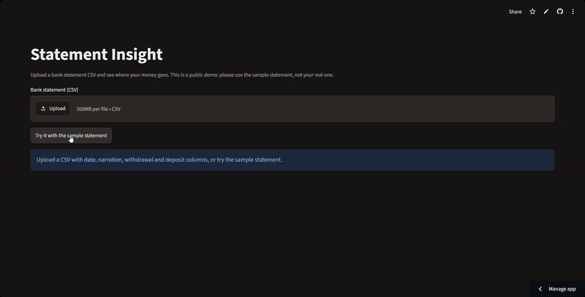
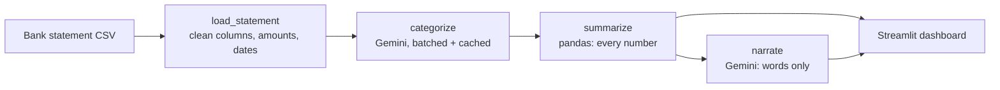

# Statement Insight

**Upload an Indian bank statement and see where your money goes: every transaction categorized by an LLM, with charts and a plain-English summary.**

**[Live demo](https://statement-insight-mohit.streamlit.app/#statement-insight)** · try it with the built-in sample statement



## What it does

- Reads bank statement CSVs from different banks (column names, Indian number formats and day-first dates are handled automatically)
- Categorizes every transaction (food delivery, groceries, bills, investments, EMIs...) and cleans up merchant names with Gemini
- Shows income vs spending by month, spending by category, and top merchants
- Writes a short, plain-English summary of your spending on request

## How it works



## Key engineering decisions

**1. Deduplicate before calling the LLM.** Repeat payments to the same merchant carry different reference numbers (`UPI/DR/431122334455/SWIGGY/...`). Stripping those numbers before comparing turns the sample's **163 transactions into 29 unique merchants**, so categorizing the whole statement takes **one LLM call instead of 163**.

**2. Batch, then verify.** All unique merchants go to Gemini in one numbered request with a strict response schema (Pydantic). The code checks that every id came back and never assumes the model returned everything.

**3. Cache results.** Categories are cached, so analysing the same statement again costs zero API calls.

**4. The LLM handles words; code handles numbers.** Every total, average and percentage is computed with pandas. The LLM only describes the computed numbers, and its prompt forbids inventing figures, so the summary can't contain made-up amounts.

## Tech stack

Python 3.12 · Gemini API (`google-genai`) · Pydantic · pandas · Streamlit · pytest · uv

## Run it locally

```bash
git clone https://github.com/mohitparashar310/statement-insight.git
cd statement-insight
uv sync
```

Create a `.env` file with your key (get one free at [Google AI Studio](https://aistudio.google.com)):

```
GEMINI_API_KEY=your-key-here
```

Then:

```bash
uv run make_sample_statement.py   # creates sample_statement.csv
uv run streamlit run app.py
```

## Tests

```bash
uv run pytest -v
```

The tests never call Gemini: the LLM is replaced with a fake, so they're fast, free and repeatable. They check Indian amount and date parsing, that one merchant with many reference numbers becomes one key, that categorization makes exactly one LLM call and then reuses the cache, and the summary arithmetic.

## Privacy

The public demo is meant for the included **sample statement**, which is generated with made-up data. Don't upload a real statement to the public demo. Run the app locally for that; only transaction descriptions are sent to Gemini for categorization.

## Limitations and next steps

- Categories are only as good as the model's knowledge of Indian merchants; small local merchants may land in "other"
- Supports CSV only; PDF statements are the most common format and are next on the list
- The cache lives on the server's temporary disk, so it resets when the app restarts
- Next: a labelled evaluation set to measure categorization accuracy, and PDF statement support

---

Built by [Mohit Parashar](https://www.linkedin.com/in/mohit-parashar-781121262) as part of a hands-on AI engineering.